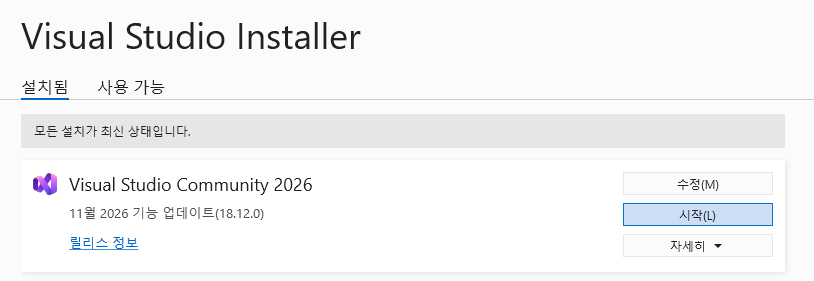
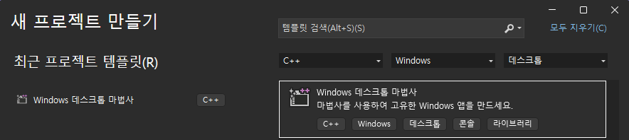
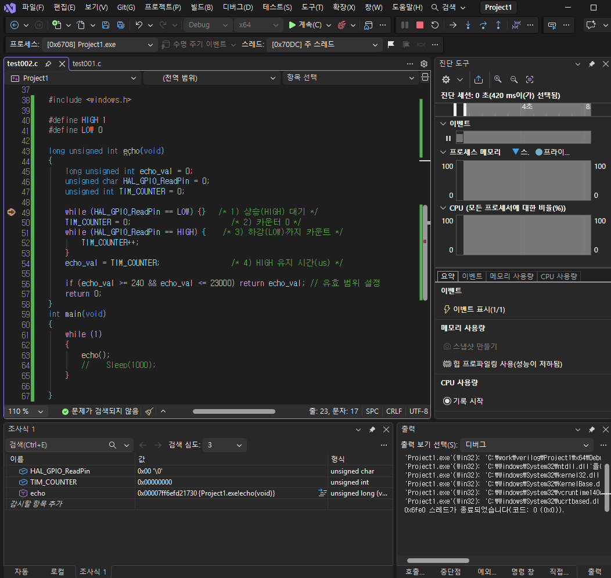
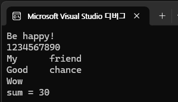
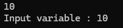
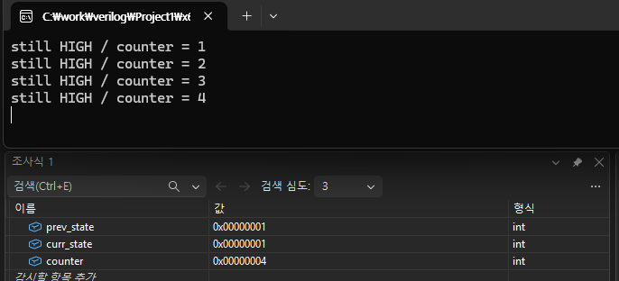

## Verilog Project

**실습 환경** : Visual Studio Community

**학습 자료** : 혼자 공부하는 C언어 (한빛미디어, 서현우)

**연관 프로젝트** : STM32F411RE

## 1. 실습 환경 구축

1. Visual Studio Community 2026 설치한다.

 <br>

2. 콘솔이 있는지 확인 후 프로젝트를 만든다.

 <br>

<details>
<summary>Debugging</summary>

다음 코드에 대한 디버깅을 진행한다.

```c
#include <stdio.h>
#include <windows.h>

#define HIGH 1
#define LOW 0

long unsigned int echo(void)
{
    long unsigned int echo_val = 0;
    unsigned char HAL_GPIO_ReadPin = 0;
    unsigned int TIM_COUNTER = 0;

    while (HAL_GPIO_ReadPin == LOW) {}   /* 1) 상승(HIGH) 대기 */
    TIM_COUNTER = 0;                        /* 2) 카운터 0 */
    while (HAL_GPIO_ReadPin == HIGH) {    /* 3) 하강(LOW)까지 카운트 */
        TIM_COUNTER++;
    }
    echo_val = TIM_COUNTER;                 /* 4) HIGH 유지 시간(us) */

    if (echo_val >= 240 && echo_val <= 23000) return echo_val; // 유효 범위 설정 
    return 0;
}
int main(void)
{
    while (1)
    {
        echo();
        //    Sleep(1000);
    }

}
```

 <br>

원하는 위치를 설정하고, 변수를 우클릭하여 `조사식 추가`를 한다.

16진수로 변환 후 값을 수정하여 while문에 대한 디버깅을 진행한다.

</details>


## 2. C언어 기초

<details>
<summary>Data Type</summary>

# C 언어 `printf()` 서식 지정자 정리

## 1. 정수형 출력

| 서식 지정자 | 의미 | 출력 예시 |
|---|---|---|
| `%d` | 10진수 부호 있는 정수 | `123` |
| `%i` | 10진수 부호 있는 정수 | `123` |
| `%u` | 부호 없는 10진수 정수 | `123` |
| `%o` | 8진수 정수 | `17` |
| `%x` | 16진수 정수 (소문자) | `ff` |
| `%X` | 16진수 정수 (대문자) | `FF` |

## 2. 실수형 출력

| 서식 지정자 | 의미 | 출력 예시 |
|---|---|---|
| `%f` | 소수점 형식으로 출력 | `3.400000` |
| `%lf` | `printf()`에서는 `%f`와 동일 | `3.400000` |
| `%e` | 지수 형식 (소문자) | `3.400000e+00` |
| `%E` | 지수 형식 (대문자) | `3.400000E+00` |
| `%g` | `%f` 또는 `%e` 중 적절한 형식 선택 | `3.4` |
| `%G` | `%g`와 유사하지만 지수에 대문자 사용 | `3.4` |

> **참고:** `printf()`에서 `double` 자료형은 `%f`를 사용한다. `%lf`도 사용할 수 있지만 `%f`와 동일하게 동작한다. 반면 `scanf()`에서는 `float`에 `%f`, `double`에 `%lf`를 사용한다.

## 3. 문자 및 문자열 출력

| 서식 지정자 | 의미 | 출력 예시 |
|---|---|---|
| `%c` | 문자 출력 | `A` |
| `%s` | 문자열 출력 | `Hello` |
| `%p` | 포인터 주소 출력 | `0x...` |

## 4. 기타 서식 지정자

| 서식 지정자 | 의미 |
|---|---|
| `%%` | `%` 문자 자체를 출력 |
| `%ld` | `long` 정수 출력 |
| `%lld` | `long long` 정수 출력 |
| `%hd` | `short` 정수 출력 |
| `%zu` | `size_t` 자료형 출력 |

## 5. 소수점 자릿수 지정하기

`%f`에서 소수점 뒤에 숫자를 지정하면 출력할 소수점 이하 자릿수를 설정할 수 있다.

| 서식 지정자 | 의미 | 출력 예시 |
|---|---|---|
| `%f` | 소수점 이하 6자리 (기본값) | `3.400000` |
| `%.1f` | 소수점 이하 1자리 | `3.4` |
| `%.2f` | 소수점 이하 2자리 | `3.40` |
| `%.3f` | 소수점 이하 3자리 | `3.400` |
| `%.5f` | 소수점 이하 5자리 | `3.40000` |
| `%.10f` | 소수점 이하 10자리 | `3.4000000000` |

**예제 코드**

```c
#include <stdio.h>

int main(void)
{
    double num = 3.4;

    printf("%f\n", num);
    printf("%.1f\n", num);
    printf("%.2f\n", num);
    printf("%.3f\n", num);
    printf("%.5f\n", num);
    printf("%.10f\n", num);

    return 0;
}
```

## 6. PC와 STM32F411 자료형 크기 비교

단위: Byte (1 Byte = 8 bit)

일반적인 ABI 및 컴파일러 환경 기준이다.

| 자료형 | Windows PC (64bit) | Linux PC (64bit) | STM32F411 (32bit) |
|---|---:|---:|---:|
| `char` | 1 | 1 | 1 |
| `short` | 2 | 2 | 2 |
| `int` | 4 | 4 | 4 |
| `long` | 4 | 8 | 4 |
| `long long` | 8 | 8 | 8 |
| `float` | 4 | 4 | 4 |
| `double` | 8 | 8 | 8 |
| `long double` | 8 | 16 | 보통 8 또는 컴파일러 의존 |
| 포인터 (`*`) | 8 | 8 | 4 |

> **주의사항**
>
> - 자료형의 크기는 운영체제뿐 아니라 컴파일러와 ABI(Application Binary Interface)에 따라 달라질 수 있다.
> - STM32F411은 32bit MCU이므로 일반적으로 포인터 크기는 4 Byte이다.
> - `long`은 Windows 64bit에서 4 Byte, 일반적인 Linux 64bit 환경에서 8 Byte이다.
> - `long double`의 크기는 컴파일러와 ABI에 따라 달라질 수 있다.
> - 실제 개발 환경에서는 `sizeof()` 연산자로 자료형의 크기를 확인하는 것이 가장 정확하다.

### 자료형 크기 확인 예제

```c
#include <stdio.h>

int main(void)
{
    printf("char       : %zu Byte\n", sizeof(char));
    printf("short      : %zu Byte\n", sizeof(short));
    printf("int        : %zu Byte\n", sizeof(int));
    printf("long       : %zu Byte\n", sizeof(long));
    printf("long long  : %zu Byte\n", sizeof(long long));
    printf("float      : %zu Byte\n", sizeof(float));
    printf("double     : %zu Byte\n", sizeof(double));
    printf("long double: %zu Byte\n", sizeof(long double));
    printf("pointer    : %zu Byte\n", sizeof(void *));

    return 0;
}
```

`sizeof()`의 반환 자료형은 `size_t`이므로 `printf()`에서는 `%zu`를 사용한다.

</details>

<details>
<summary>printf(), scanf()</summary>

```c   
#include <stdio.h>

int main(void)
{
    printf("Be happy\n");          // \n : 줄바꿈 (New Line)
    printf("12345678901234567890\n"); 
    printf("My\tfriend\n");        // \t : Tab
    printf("Goot\bd\tchance\n");    // \b : Backspace
                                   // \t : Tab
    printf("Cow\rW\a\n");          // \r : 줄의 맨 앞으로 이동
                                   // \a : 경고음 
    return 0;
}
```

 <br>

```c
#define _CRT_SECURE_NO_WARNINGS
#include <stdio.h>

int main(void)
{
    int a;

    scanf("%d", &a);
    //scanf_s("%d", &a);
    printf("input : %d\n", a);

    return 0;
}
```

 <br>

</details>

<details>
<summary>연산자</summary>

```c   
#include <stdio.h>

int main(void)
{
    int a, b;
    int sum, sub, mul, inv, mod;

    a = 10;
    b = 20;
    sum = a + b;
    sub = a - b;
    mul = a * b;
    float div = (float)a / (float)b; // Type casting(형 변환)
    mod = a % b;
    inv = -a;

    printf("a :%d, b=%d\n", a, b);
    printf("sum :%d\n", sum);
    printf("sub :%d\n", sub);
    printf("mul :%d\n", mul);
    printf("inv :%d\n", inv);
    printf("div :%f\n", div);
    printf("mod :%d\n", mod);

    return 0;
}
```

</details>

<details>
<summary>if ~ else</summary>

```c   
#include <stdio.h>

int main(void)
{
	int a = 0, b = 0;

	if (a > 0) {
		b = 1;	
	}
	else if (a == 0) {
		b = 2;
	}
	else {
		b = 3;
	}
	
	printf("b : %d\n", b);
}
```

</details>
<details>
<summary>switch ~ case</summary>

```c   
#include <stdio.h>

int main(void)
{
    int num;

    printf("1~3 사이의 숫자를 입력하세요: ");
    scanf("%d", &num);

    switch (num)
    {
    case 1:
        printf("월요일\n");
        break;

    case 2:
        printf("화요일\n");
        break;

    case 3:
        printf("수요일\n");
        break;

    default:
        printf("잘못된 입력입니다.\n");
        break;
    }

    return 0;
}
```

</details>
<details>
<summary>example</summary>

if ~ else와 switch ~ case문을 비교한다.

다음은 if ~ else 예제 코드이다.

```c   
#include <stdio.h>
#include <windows.h>
#define HIGH 1
#define LOW  0

int main(void)
{
    int prev_state = LOW;
    int curr_state = LOW;

    while (1){
        printf("current input (0: LOW, 1: HIGH): ");
        scanf("%d", &curr_state);

        // Rising Edge 검출 (LOW -> HIGH)
        if (prev_state == LOW && curr_state == HIGH){
            printf("Rising Edge!\n");
        }

        // Falling Edge 검출 (HIGH -> LOW)
        if (prev_state == HIGH && curr_state == LOW){
            printf("Falling Edge!\n");
        }

        // 이전 상태 갱신
        prev_state = curr_state;
    }

    return 0;
}
```

다음은 switch ~ case 예제 코드이다.

```c   
#include <stdio.h>
#include <windows.h>
#define HIGH 1
#define LOW  0

int main(void)
{
    int prev_state = LOW;
    int curr_state = LOW;
    int counter = 0;

    while (1)
    {
        // 디버깅으로 진행
        switch (prev_state * 2 + curr_state)
        {
        case 0:  // LOW -> LOW
            printf("still LOW\n");
            break;

        case 1:  // LOW -> HIGH
            printf("Rising Edge!\n");
            break;

        case 2:  // HIGH -> LOW
            printf("Falling Edge!\n");
            break;

        case 3:  // HIGH -> HIGH
            counter++;
            printf("still HIGH / counter = %d\n", counter);
            break;
        }

        prev_state = curr_state;
    }

    return 0;
}
```

switch 예제 코드는 scanf 사용자 입력이 아닌 디버깅을 사용하여 출력을 확인한다.

 <br>

**핵심** 

1. if문은 우선순위가 존재한다.

2. switch문은 입력값에 따라 분기된다.

3. Verilog / 반도체 설계 관점에서 설계 대상에 따라 적절한 문법을 선택한다.

</details>


---

